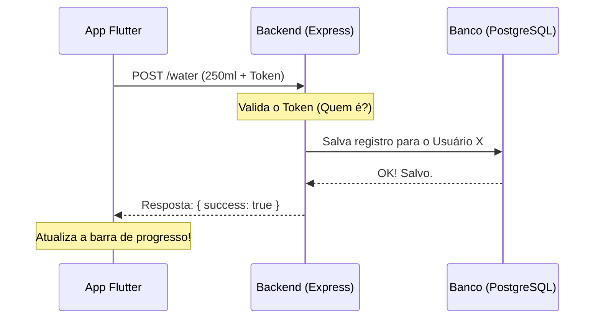

# 🚀 Guia Didático: O Backend do Bebeu!

Olá! Vou te explicar como funciona o "coração" do seu projeto — o backend. Pense no backend como o garçom e a cozinha de um restaurante: o cliente (seu aplicativo Flutter) faz um pedido, o backend processa, busca os ingredientes (dados no banco) e entrega o prato pronto.

---

## 🏗️ 1. A Estrutura de Tecnologia

O seu backend foi construído com as tecnologias mais modernas do mercado:

- **Node.js**: O motor que executa o código Javascript no servidor.
- **TypeScript**: Uma camada de segurança por cima do Javascript que evita erros bobos de digitação e lógica.
- **Express**: O framework que gerencia as "rotas" (os endereços que o App chama, como `/login`).
- **Prisma**: O nosso "Tradutor de Banco de Dados". Em vez de escrever códigos complexos em SQL, falamos com o banco usando código TypeScript simples.
- **PostgreSQL**: O banco de dados onde tudo fica guardado com segurança.

---

## 🗄️ 2. O Banco de Dados (Prisma)

No arquivo `prisma/schema.prisma`, definimos como os dados são organizados. Temos duas tabelas principais:

### 👤 Usuário (User)
Guarda quem é você.
- `name`: Seu nome.
- `email`: Seu login único.
- `password`: Sua senha (que guardamos escondida/criptografada).
- `dailyGoal`: Sua meta diária de água (padrão 2000ml).

### 💧 Registro de Água (WaterLog)
Guarda cada "copo" que você bebeu.
- `amount`: Quanto você bebeu (ex: 200ml).
- `date`: Quando foi.
- `userId`: A quem esse registro pertence (ligação com o Usuário).

---

## 🔐 3. Segurança e Autenticação

Não queremos que ninguém bisbilhote sua hidratação, certo?

1. **Bcrypt**: Quando você se cadastra, não salvamos sua senha real. O Bcrypt a transforma em um "embaralhado" impossível de ler. No login, ele compara se o que você digitou gera o mesmo embaralhado.
2. **JWT (JSON Web Token)**: Quando você loga, o servidor te dá uma "chave digital" (Token). Seu App Flutter guarda essa chave e a envia em todos os pedidos futuros (como adicionar água). Assim, o servidor sabe que é você sem precisar pedir a senha toda hora.

---

## 🛣️ 4. As Rotas (O que o App pode pedir?)

As rotas estão em `src/routes.ts` e a lógica em `auth.ts` e `water.ts`:

- **POST `/register`**: Cria sua conta.
- **POST `/login`**: Valida sua senha e te entrega o Token.
- **POST `/water`**: Adiciona um novo registro de água. (Precisa estar logado!)
- **GET `/water/today`**: Calcula quanto você já bebeu hoje somando todos os seus registros desde a meia-noite.
- **GET `/water/history`**: Pega seu histórico dos últimos 7 dias.

---

## 🔄 5. Fluxo de uma Ação (Ex: Adicionar Água)



---

## 🛠️ 6. Como rodar o Backend?

Se você quiser ligar o servidor no seu computador:

1. Certifique-se de ter o Node.js instalado.
2. No terminal, entre na pasta `backend`.
3. Rode `npm install` (instala as ferramentas).
4. Configure o seu `.env` com a URL do seu banco (Supabase/PostgreSQL).
5. Rode `npm run dev` (inicia o servidor em modo de desenvolvimento).

---

**Pronto!** Agora você tem um backend profissional, seguro e escalável rodando para o seu APP Bebeu! 🥤✨

---

## 🚀 7. Próximas Ações (O que podemos implementar?)

O backend está pronto para crescer! Aqui estão algumas ideias de funcionalidades futuras:

1.  **Editar Perfil**: Criar um endpoint `PUT /user` para permitir que o usuário mude seu nome ou atualize sua meta diária de água.
2.  **Remover Registro**: Um endpoint `DELETE /water/:id` para que o usuário possa apagar um registro caso tenha digitado errado.
3.  **Ranking de Amigos**: Adicionar a possibilidade de seguir outros usuários e ver quem está alcançando a meta (ex: `GET /friends/ranking`).
4.  **Sistema de Conquistas**: Salvar no banco quando o usuário bater a meta por 7 dias seguidos e entregar um selo virtual.

---

## 🛠️ 8. Guia: Como criar um novo Endpoint?

Se você quiser adicionar uma nova funcionalidade (por exemplo, "Excluir um registro de água"), o caminho é sempre este:

### Passo 1: Definir a Lógica (Controlador)
No arquivo correspondente (ex: `src/water.ts`), crie a função que faz o trabalho:
```typescript
export async function deleteWater(req: AuthRequest, res: Response) {
    const { id } = req.params; // Pega o ID da água pela URL
    await prisma.waterLog.delete({ where: { id } });
    return res.json({ message: "Removido com sucesso!" });
}
```

### Passo 2: Registrar a Rota
No arquivo `src/routes.ts`, diga ao servidor qual endereço (URL) levará a essa função:
```typescript
// Exemplo: rota para deletar água
router.delete("/water/:id", authMiddleware, deleteWater);
```

### Passo 3: Testar!
Use uma ferramenta como **Postman**, **Insomnia** ou o próprio **Thunder Client** (extensão do VS Code) para enviar o pedido ao servidor e ver se ele responde corretamente.
