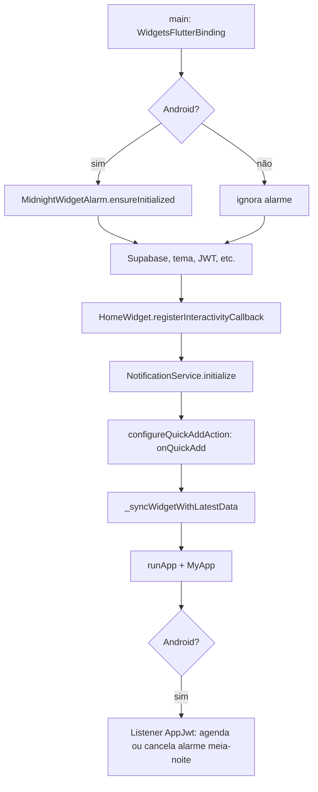
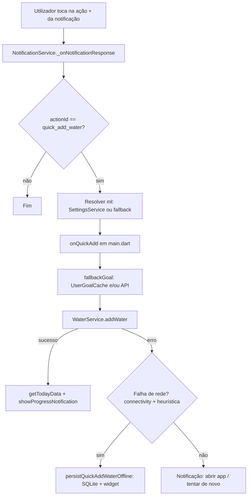
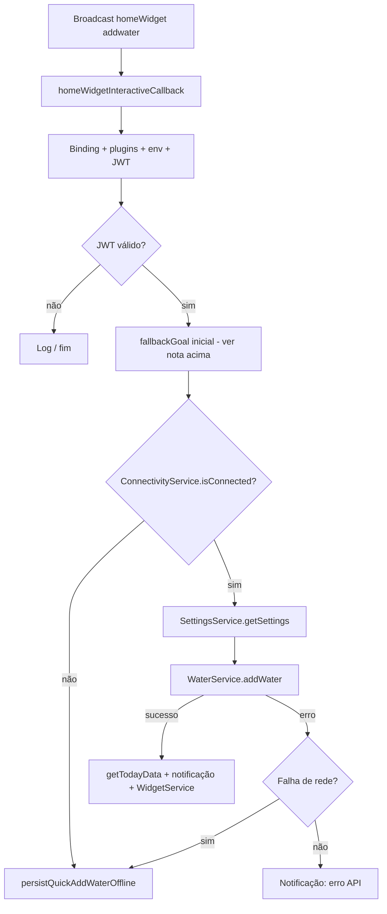
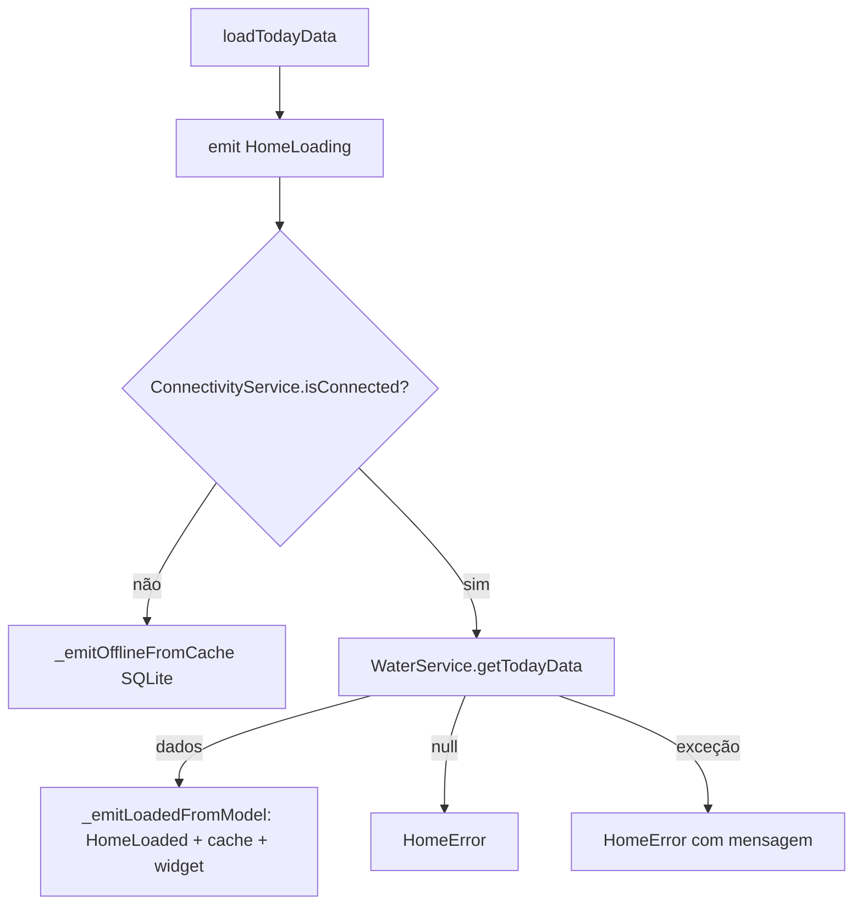
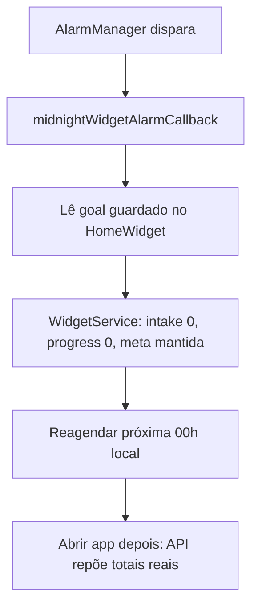
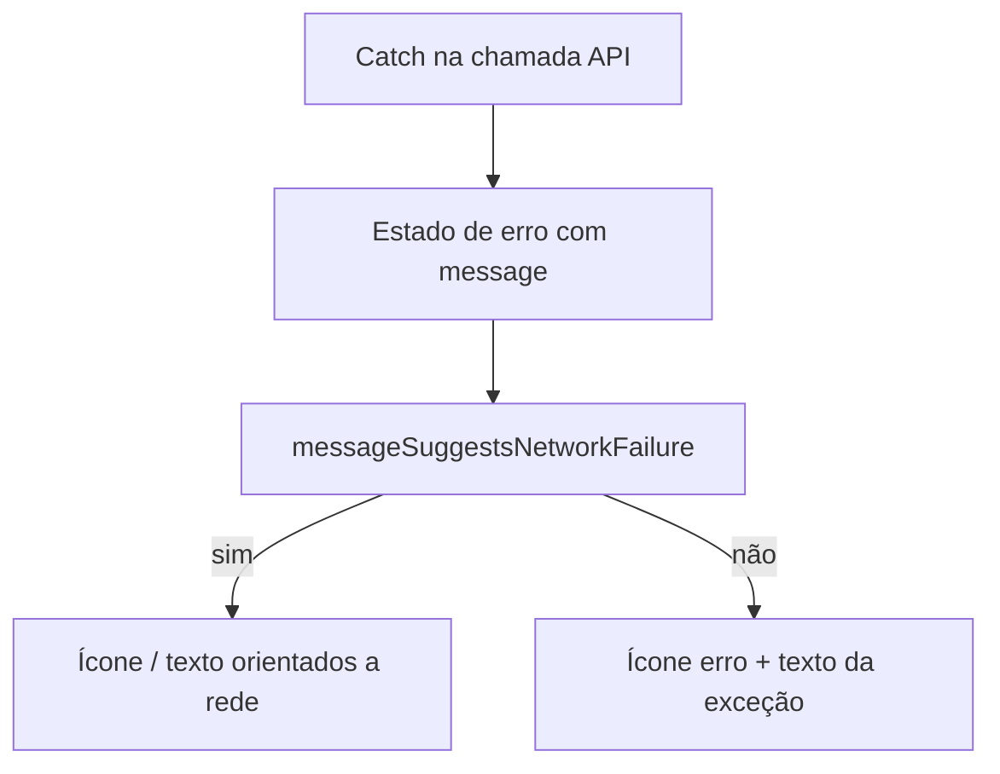

# Fluxos principais — Bebeu

Diagramas em [Mermaid](https://mermaid.js.org/) (GitHub, Notion ou [mermaid.live](https://mermaid.live) renderizam automaticamente).

---

## 1) Arranque do app (`main.dart`)

---

## 2) Toque no “+” da **notificação** (lembrete)

O handler em `NotificationService` reage à **ação** `quick_add_water`. Antes exigia também `payload == hydration_recurring`; em alguns OEMs o `payload` vinha vazio e o “+” não fazia nada.

---

## 3) Toque no “+” do **widget** Android (background)

Callback: `lib/core/home_widget_interactive.dart` (`@pragma('vm:entry-point')`).

> **Nota:** no código atual `fallbackGoal` inicia em `2000` se não houver `getSettings`; existe `UserGoalCache` (SharedPreferences) usado noutros fluxos — alinhar aqui evita meta errada offline só no widget.

---

## 4) Home — carregar o dia (`HomeCubit.loadTodayData`)

---

## 5) Meia-noite — widget na launcher (`MidnightWidgetAlarm`)

---

## 6) Erro na UI — rede vs API (`network_error_heuristics`)

Usado em `alerts_view`, `history_view`, `settings_view` para não mostrar “sem Wi‑Fi” em todo erro.

---

## 7) Mapa de ficheiros (referência rápida)

| Área | Ficheiros principais |
|------|----------------------|
| Arranque + quick add notificação | `lib/main.dart` |
| Lembretes + ação + | `lib/core/services/notification_service.dart` |
| Widget “+” em background | `lib/core/home_widget_interactive.dart` |
| Offline quick add partilhado | `lib/core/services/quick_add_offline_persist.dart` |
| Meta em prefs (quando integrado) | `lib/data/local/user_goal_cache.dart` |
| Home online/offline | `lib/presentation/home/cubit/home_cubit.dart` |
| Ajustes | `lib/presentation/home/cubit/settings_cubit.dart` |
| Alarme meia-noite | `lib/core/services/midnight_widget_alarm.dart` |
| Manifest Android (alarme + widget) | `android/app/src/main/AndroidManifest.xml` |

---

*Última atualização: fluxos alinhados à estrutura atual do repositório bebeu.*
